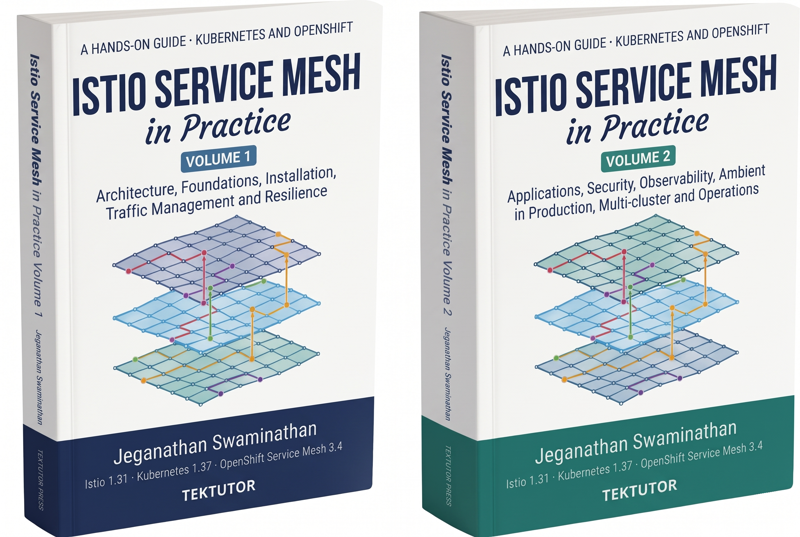

# Istio Service Mesh ( 25-27 November 2026 )

  

This course is based on ***Istio Service Mesh in Practice***, Volume 1 and Volume 2, by Jeganathan Swaminathan, TekTutor Press.
Order your copies from my WhatsApp catalog: [wa.me/c/918220005626](https://wa.me/c/918220005626) (WhatsApp +91 822-000-5626).

## Login Credentials
<pre>
Cloud Password - P@lmeto@123
Ubuntu Password - palmeto@123
</pre>

## What is in this repository

Lab kit for the workbook *Istio Workbook Module 1: Why Netbanking Needs a Service Mesh*.
Each lab in the workbook starts with a `cd` into one of these folders.

| Folder | What it holds |
| --- | --- |
| `Day1/netbanking-lab/` | Netbanking source code (`app/`) and manifests (`deploy/`): Lab 1, Problems 1 to 6, Lab 2 |
| `Day1/labs/` | Labs 07 and 09 (used by Problem 6 and Lab 2), then Labs 10 to 14: Envoy, sidecar injection, multi-cluster, ambient |
| `Day1/openshift-istio-kiali/` | Trainer only: scripts that install OpenShift Service Mesh and Kiali |
| `Day2/labs/` | Labs 01 to 17: routing, canary, mirroring, timeouts, retries, outlier detection, circuit breaking, fault injection, gateways, egress, upgrades, failure scenarios |
| `Day3/labs/` | Labs 01 to 14: mTLS, authorization, JWT, Kiali, access logs, tracing, ingress, egress control, certificates, troubleshooting, metrics, istioctl, production readiness |

Every lab folder has a `README.md` with its `cd` command and its files.
